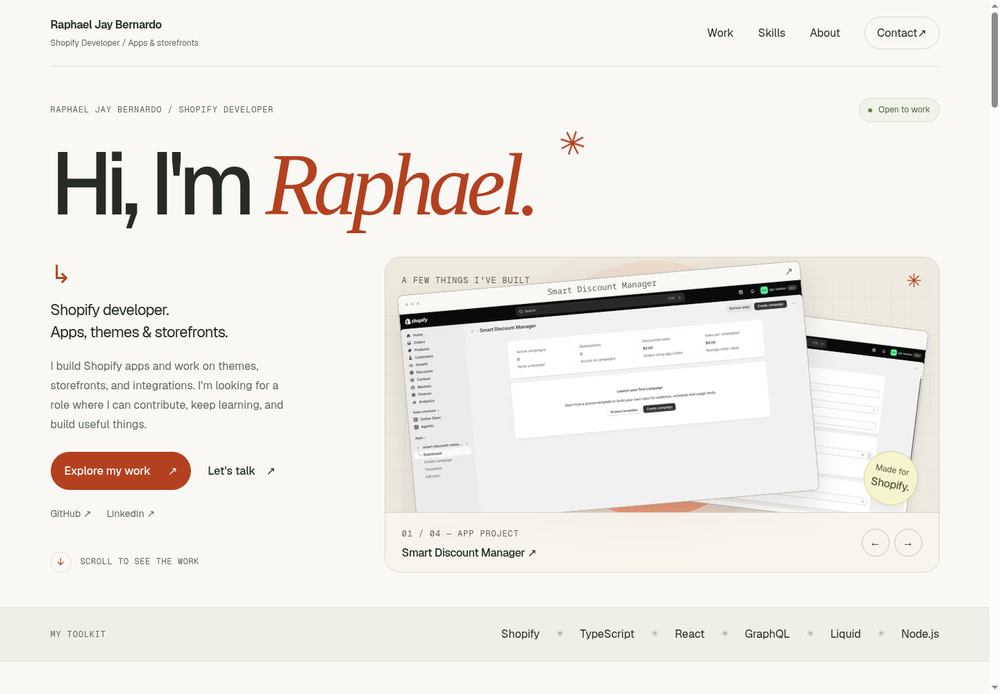
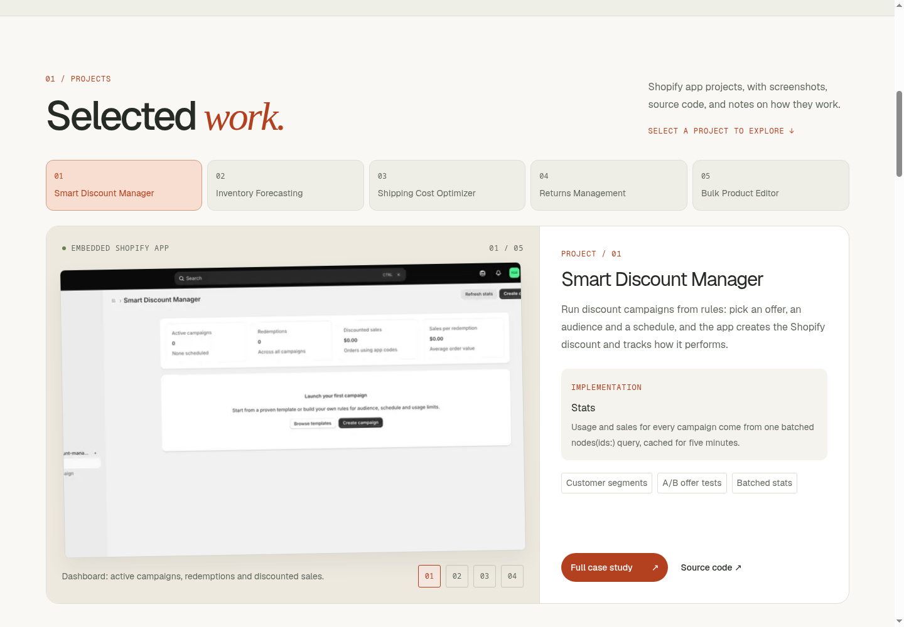
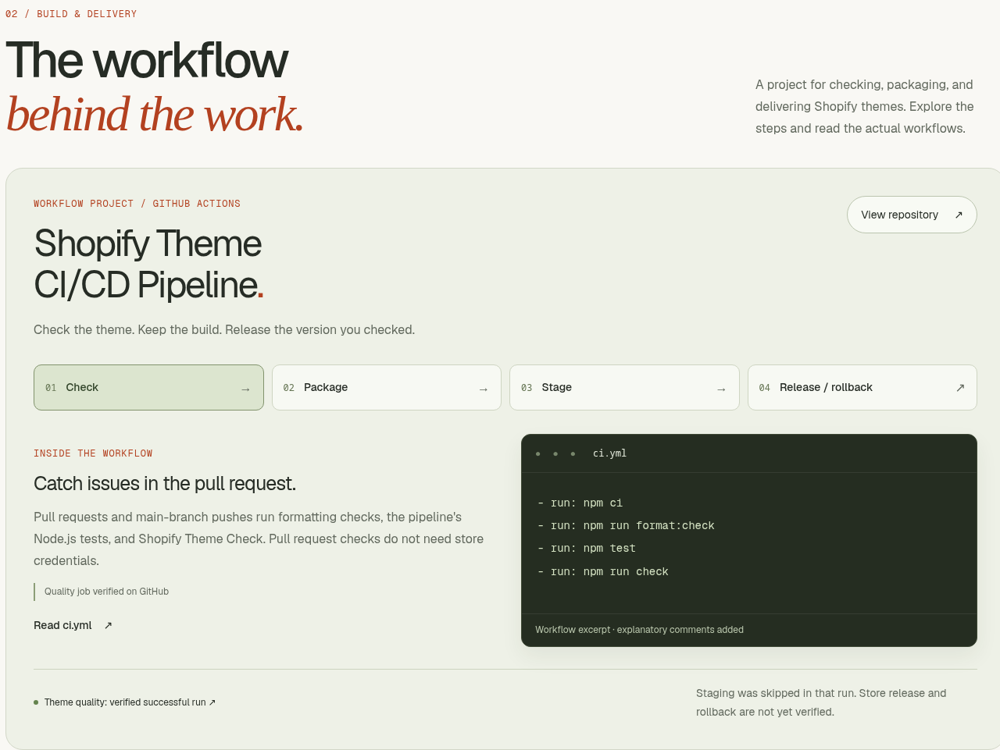
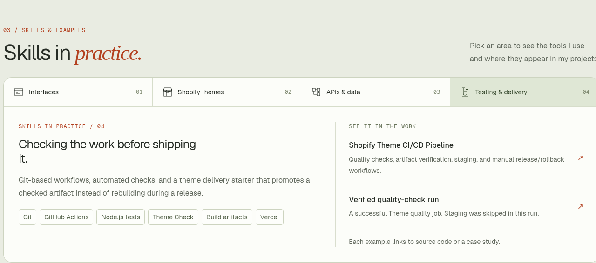
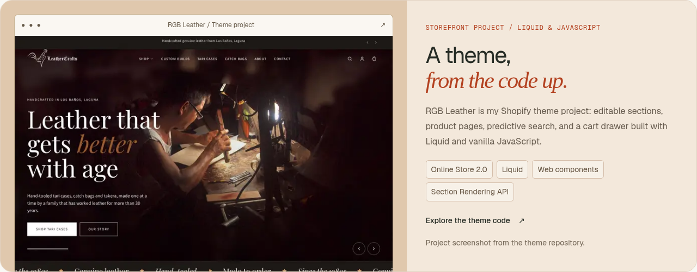
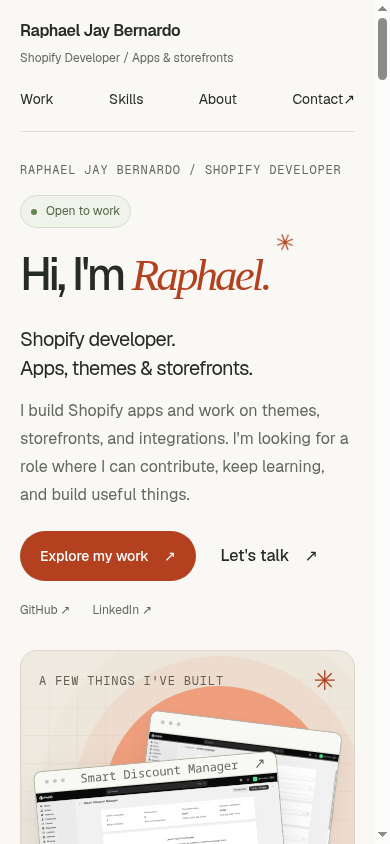

# Raphael Jay Bernardo — Shopify Developer

A personal portfolio for Shopify apps, storefronts, and integrations, built with Next.js 16 (Cache Components), Tailwind CSS 4, and Neon Postgres. Deployed on Vercel.

[Live portfolio](https://portfolio-website-gules-mu-98.vercel.app) · [LinkedIn](https://www.linkedin.com/in/raphael-jay-bernardo-4b7906355/) · [Brand guide](docs/brand.md)

## Preview

Actual screenshots of the production build, updated November 13, 2026.



<details>
<summary>Projects, CI/CD, skills, and mobile previews</summary>











</details>

## Features

- An expressive light theme, oversized personal introduction, layered app previews, and clear contact links.
- Featured screenshot carousel with previous/next controls and reduced-motion-aware pointer movement.
- Five-project explorer with screenshot selection, keyboard-accessible tabs, and links to case studies and source code.
- Interactive CI/CD project walkthrough with source excerpts and a verified GitHub quality-check run.
- RGB Leather theme showcase and a skills browser that links tools to project evidence.
- Direct email and LinkedIn links, plus an email-copy control.
- Responsive layouts with 16 px body copy, 14 px supporting text, labels at least 12 px, visible keyboard focus, reduced-motion support, and a generated social-sharing image.
- Case studies covering the problem, features, implementation, screenshots, stack, and access scopes.

## Content

- **Apps**: the five Shopify apps live in `src/lib/projects.ts`, with screenshots in `src/content/screenshots/`. Each has a case-study page at `/projects/<slug>`.
- **How I work**: process steps and toolkit in `src/lib/process.ts`.
- **Skills and CI/CD**: source-linked examples and pipeline stages in `src/lib/skills.ts`; verification notes in [project evidence](docs/project-evidence.md).
- **Stores**: store work is read from the `stores` table in Neon; the section stays hidden when no published stores are available.
- **Name, intro, contact links**: `src/lib/site.ts`.

## CI/CD project

The portfolio features my [Shopify Theme CI/CD Pipeline](https://github.com/rjaybernardo/Shopify-Theme-CI-CD-Pipeline), including quality checks, artifact verification, conditional staging, and manual release/rollback workflows. [This verified run](https://github.com/rjaybernardo/Shopify-Theme-CI-CD-Pipeline/actions/runs/43118893366) passed the Theme quality job; staging was skipped. Store release and rollback remain unverified.

This theme pipeline is a separate project. The portfolio website uses its existing GitHub-to-Vercel deployment integration.

## Setup

```sh
npm install
cp .env.example .env.local   # fill in DATABASE_URL from Neon
npm run db:setup             # creates the stores table
npm run dev
```

## Deploy (Vercel + Neon)

1. Import the GitHub repo in Vercel.
2. In the project, open **Storage → Connect Database → Neon** (creates the database and sets `DATABASE_URL`).
3. Add `NEXT_PUBLIC_SITE_URL` (e.g. `https://your-site.vercel.app`) and `REVALIDATE_SECRET` (any random string) under **Settings → Environment Variables**, then redeploy.
4. Pull the env locally with `vercel env pull .env.local` (or copy `DATABASE_URL` by hand) and run `npm run db:setup` once.

## Adding a store

From the command line:

```sh
npm run store:add -- --name "Store name" --url https://store.com \
  --role "Theme development" --summary "Rebuilt the PDP and cart drawer." \
  --tags "Liquid,Online Store 2.0" --period 2026 --order 10
```

Or in the Neon SQL editor:

```sql
INSERT INTO stores (name, url, role, summary, tags, period, sort_order)
VALUES ('Store name', 'https://store.com', 'Theme development',
        'Rebuilt the PDP and cart drawer.', ARRAY['Liquid', 'Online Store 2.0'], '2026', 10);
```

Stores are ordered by `sort_order` (highest first). Set `published = false` to hide one, and `image_url` to show a screenshot.

The page caches stores for up to an hour. `store:add` refreshes the live site automatically when `NEXT_PUBLIC_SITE_URL` and `REVALIDATE_SECRET` are in `.env.local`; after editing in the SQL editor, run:

```sh
curl -X POST -H "Authorization: Bearer $REVALIDATE_SECRET" https://your-site.vercel.app/api/revalidate
```
